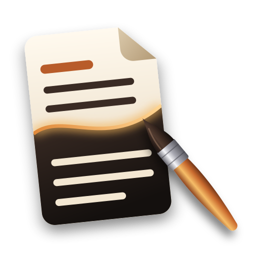
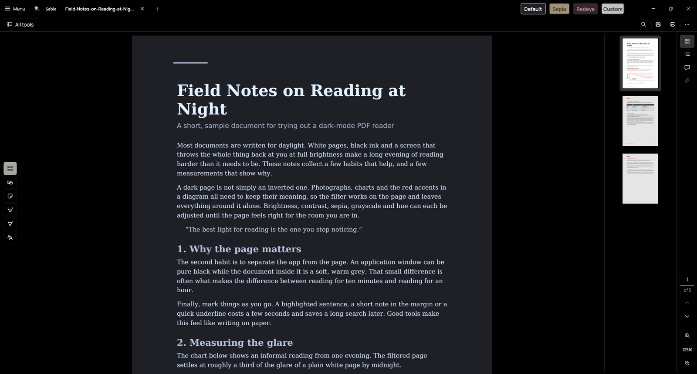
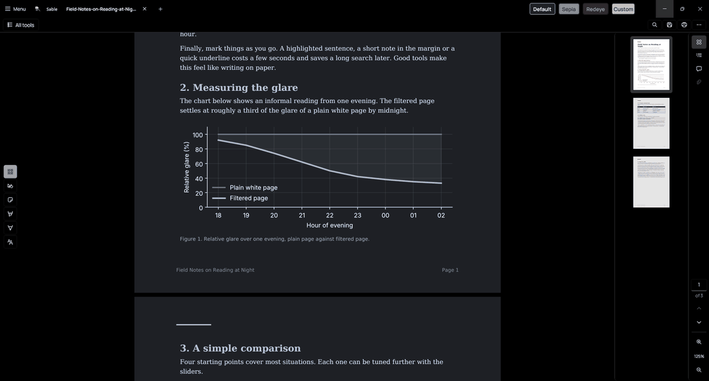
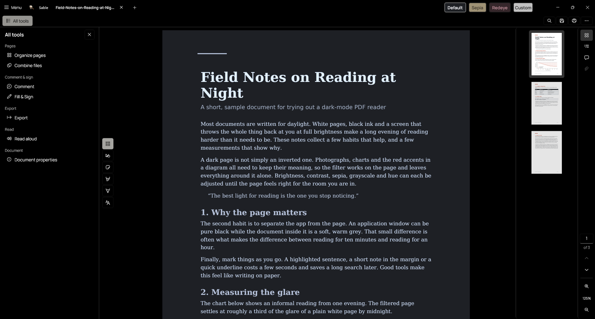
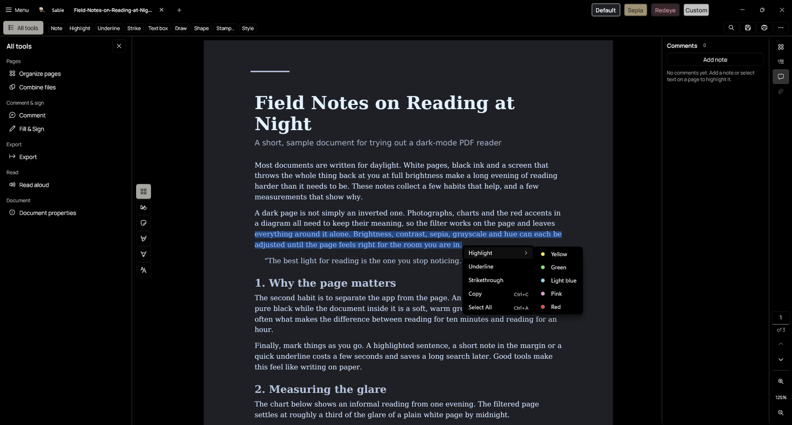
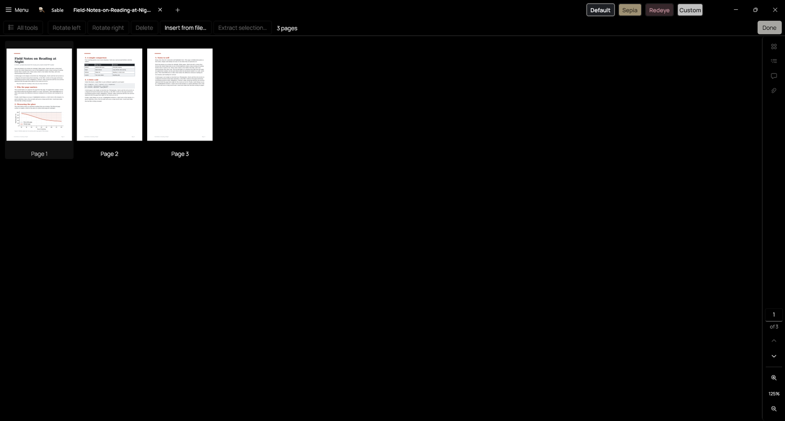
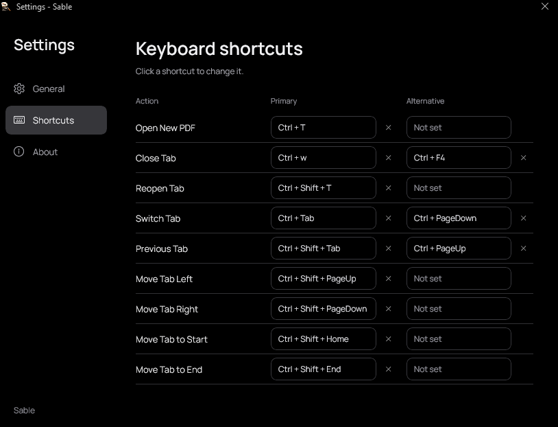

<p align="center">
  
</p>

<h1 align="center">Sable</h1>

<p align="center">
  <b>A native dark-mode PDF reader for Windows.</b><br>
  C++/WinRT, WinUI 3, PDFium and Direct2D.
</p>

<p align="center">
  <a href="https://github.com/abhilxsh07/sable/releases/tag/v1.0.0-alpha.1"></a>
  <a href="https://github.com/abhilxsh07/sable/actions/workflows/pull.yaml"></a>
  <a href="LICENSE"></a>
  
  
</p>

<p align="center">
  <a href="#download">Download</a> ·
  <a href="#features">Features</a> ·
  <a href="#how-its-built">How it's built</a> ·
  <a href="#building">Build from source</a> ·
  <a href="#credits">Credits</a>
</p>

<p align="center">
  
</p>

Sable reads PDFs in the dark. The night filter recolours the page itself, not
the app around it, and keeps the presets, sliders and keybinds of
[NightPDF](https://github.com/Lunarequest/NightPDF), the Electron app Sable is
ported from. Around the filter is a full desktop reader: tabs, thumbnails,
outlines, Find, comments, form filling, page organizing, export and printing.

It's about a 5 MB download, runs entirely on your machine, and has no accounts
and no cloud. The only network request it makes is an update check against
GitHub, which you can turn off in Settings.

> **Status: alpha.** `v1.0.0-alpha.1` is a preview for testing. The installers
> are unsigned, so Windows SmartScreen may warn you. See [Status](#status) for
> what has and hasn't been checked yet.

## Night filters

Four presets (Default, Sepia, Redeye and Custom) with six sliders behind
Custom, the same values and the same filter math as NightPDF. The filter is
applied in Direct2D and only touches the page. The interface, thumbnails and
printouts keep their real colours.

<p align="center">
  
</p>

Settings also offers **Obsidian (AMOLED)**, which makes every app surface pure
black. It is separate from the PDF's night filter.

## Screenshots

<table>
  <tr>
    <td width="50%"><br><sub><b>All tools.</b> Every tool in one grouped list, plus a quick-tools strip beside the page.</sub></td>
    <td width="50%"><br><sub><b>Comments.</b> Highlight, underline, strikethrough, notes, text boxes, drawing, shapes and stamps.</sub></td>
  </tr>
  <tr>
    <td width="50%"><br><sub><b>Organize pages.</b> Rotate, delete, reorder, insert and extract pages.</sub></td>
    <td width="50%"><br><sub><b>Shortcuts.</b> NightPDF's keybinds, each with a primary and an alternative you can change.</sub></td>
  </tr>
</table>

## Features

**Reading**
- PDFs open in tabs, each remembering its own Find query, sidebar, layout and cursor tool.
- Thumbnails, outlines, page labels, internal and web links, password prompts and attachment saving.
- Vertical, horizontal, wrapped and page scrolling, with no/odd/even spreads and click-to-turn.
- Hand tool, text selection and copy, view rotation, zoom, full screen and presentation mode.
- Two-finger scrolling and pinch zoom on precision trackpads. The page sharpens after the gesture.
- Find with next/previous, result counts, wrap and highlight all.
- Read Aloud with Windows' built-in voices, with speed and voice choice.

**Comments and annotations**
- Sticky notes, highlight, underline and strikethrough.
- Text boxes (including Hindi and Bengali text), freehand drawing, rectangles, ellipses, lines and arrows.
- Image stamps. Every annotation can be edited or removed afterwards.

**Forms and signing**
- Fill text, check box, radio, combo and list fields.
- Fill & Sign: add text, check marks, and typed or drawn signatures (visual signatures, not certificate signatures).

**Pages and files**
- Reorder, rotate, delete, insert and extract pages.
- Combine several PDFs into one.
- Export pages as PNG or JPEG, or export the document's text.
- Export and Combine run in the background and can be cancelled.
- Save a Copy keeps your annotations. A copy with no edits keeps the original bytes.
- Windows print preview, printing in the page's original colours.
- Drop PDFs onto Home or an open reader to open them.

**Everything else**
- A music button with playback controls, track info, artwork and a seek bar for Spotify and Apple Music sessions that Windows exposes.
- Windows contrast themes, named controls for screen readers, and the current page's text for Narrator.
- Panes and notices animate, and stay still when Windows' animation effects are off.
- Logs under `%LOCALAPPDATA%\Sable\logs`, rotated at 2 MiB.

The complete list, with what is done and what is left, is in the
[feature checklist](docs/FEATURE_CHECKLIST.md).

## Download

Get the files from the
[v1.0.0-alpha.1 release page](https://github.com/abhilxsh07/sable/releases/tag/v1.0.0-alpha.1).

| | Installer (recommended) | Portable ZIP |
|---|---|---|
| Intel / AMD (x64) | [Sable-v1.0.0-alpha.1-x64-setup.exe](https://github.com/abhilxsh07/sable/releases/download/v1.0.0-alpha.1/Sable-v1.0.0-alpha.1-x64-setup.exe) | [x64.zip](https://github.com/abhilxsh07/sable/releases/download/v1.0.0-alpha.1/Sable-v1.0.0-alpha.1-x64.zip) |
| Windows on ARM (ARM64) | [Sable-v1.0.0-alpha.1-ARM64-setup.exe](https://github.com/abhilxsh07/sable/releases/download/v1.0.0-alpha.1/Sable-v1.0.0-alpha.1-ARM64-setup.exe) | [ARM64.zip](https://github.com/abhilxsh07/sable/releases/download/v1.0.0-alpha.1/Sable-v1.0.0-alpha.1-ARM64.zip) |

- **Installer.** Installs for your user account without asking for an
  administrator. You pick the folder and shortcuts, and at the end you can open
  Settings > Default apps to make Sable your PDF app (Windows only lets you set
  that one yourself).
- **ZIP.** Extract the whole folder and run `Sable.exe`. It doesn't register
  itself for PDFs.
- **Runtime.** Sable needs Microsoft's Windows App Runtime 2.5 or newer. The
  installer checks for it and installs it if it's missing. The ZIP tells you at
  startup and links to Microsoft's download.
- **Unsigned.** If SmartScreen warns you, choose *More info* and *Run anyway*.
  You can check a download against `SHA256SUMS.txt` from the release page with
  `Get-FileHash <file>` in PowerShell.

Open a PDF from the command line, optionally on a given page:

```powershell
Sable -p 5 file.pdf
```

### Keyboard shortcuts

These are NightPDF's, plus a few reader keys. You can rebind shortcuts in
Settings > Shortcuts.

| Keys | Action |
|---|---|
| Ctrl+F | Open Find |
| Enter, F3 or Ctrl+G | Next Find match; add Shift for the previous match |
| Ctrl+Alt+G | Select the page-number box |
| Ctrl++ / Ctrl+- / Ctrl+0 | Zoom in, out or reset; keypad aliases work too |
| R / Shift+R | Rotate the reading view clockwise / counterclockwise |
| H / S | Hand tool / text selection |
| F4 | Hide or reopen the last sidebar |
| Ctrl+S / Ctrl+P | Save a copy / print |
| Ctrl+Alt+P | Presentation mode; Escape leaves it |
| F11 | Toggle full screen |

## How it's built

- **UI.** WinUI 3 on the Windows App SDK 2.x, written in C++20 with C++/WinRT.
- **PDF engine.** PDFium, pinned to a specific Chromium build
  (`.pdfium_version`). All PDFium work happens on one dedicated engine thread,
  and the UI thread never calls into it.
- **Night filter.** Direct2D, following the same maths as NightPDF's presets.
- **Accessibility.** The current page is exposed to UI Automation as a document
  with a text pattern, and its text is only fetched when a screen reader asks.
- **Build and release.** Pinned dependencies, scripted restore, build, test and
  format steps, and a GitHub Actions workflow that checks formatting, builds
  x64 and ARM64 and runs the tests on x64. Release ZIPs are built in a stable
  order with a manifest and SHA-256 sums, and the installer is an NSIS script.
- **Tests.** Over 600 GoogleTest tests cover the engine, rendering against
  golden images, annotations, forms, export, printing, keybinds and the UI
  logic, along with malformed-input, cache, cancellation and lifetime cases.
- **Size.** Roughly 46,000 lines of app code and 40,000 lines of tests.
- **Written down.** [DESIGN.md](docs/DESIGN.md) is the scope and layout.
  [DECISIONS.md](docs/DECISIONS.md) records the reasoning behind each choice,
  and [TEST_PLAN.md](docs/TEST_PLAN.md), [READER_CHECKS.md](docs/READER_CHECKS.md)
  and [RELEASING.md](docs/RELEASING.md) cover verification and shipping.

## Status

Sable is an alpha. Parity with NightPDF came first, and the reader has grown
past it since. Done and covered by the tests: everything listed under
[Features](#features).

Still open, in the order they matter:

- Real-player checks for the Spotify and Apple Music pane, and for switching
  between them.
- A run on a clean Windows PC or VM with no development tools installed, and on
  real Windows on ARM hardware. The ARM64 builds are made and checked, but not
  yet run on ARM hardware.
- Long-duration leak checks and device-loss and sleep/resume checks.
- Signed installers.
- PDF layers, which the pinned PDFium API can't toggle, and a broader shape
  editor.

The full, dated list is in the [feature checklist](docs/FEATURE_CHECKLIST.md).
Bug reports are welcome, and a sample PDF that shows the problem helps most.

## Credits

Sable is based on [NightPDF](https://github.com/Lunarequest/NightPDF), first
released by Joe Loya and later maintained at Lunarequest/NightPDF (copyright
Advaith Madhukar and contributors). The design, the presets and pretty much
all of the behaviour come from there.

Sable is not an official successor to NightPDF and isn't endorsed by its
maintainer.

## Building

You'll need:

-   Windows 10 or 11 (x64 or ARM64)
-   Visual Studio 2022 (17.10 or later) with the "WinUI application
    development" workload (including "C++ WinUI app development tools") and
    "Desktop development with C++"
-   [uv](https://docs.astral.sh/uv/), which takes care of Python 3.12

```powershell
uv run update_pdfium.py --pinned      # download the pinned PDFium build
powershell -NoProfile -ExecutionPolicy Bypass -File scripts/build.ps1
powershell -NoProfile -ExecutionPolicy Bypass -File scripts/test.ps1
powershell -NoProfile -ExecutionPolicy Bypass -File scripts/run.ps1 file.pdf
```

The build script uses the 64-bit compiler host for both targets. Release
keeps whole-program optimization enabled.

Run `uv run update_pdfium.py` without `--pinned` to move to the latest
[pdfium-binaries](https://github.com/bblanchon/pdfium-binaries) release.

The pre-commit hook checks formatting. Turn it on with
`git config core.hooksPath .githooks`.

### Diagnostics

Logs are written under `%LOCALAPPDATA%\Sable\logs`, with one
`Sable-<process-id>.log` per process. Each file rotates at 2 MiB with three
backups. Startup keeps the current log set and the nine newest other sets.
Active or locked sets may stay longer. Set `DEBUG` to a nonempty value for
debug-level entries. Even `DEBUG=0` enables them, matching NightPDF.
An unavailable log folder does not stop the reader.

## Licenses

-   [Sable](LICENSE) is under [GPLv2 only](LICENSE)
-   [NightPDF](https://github.com/Lunarequest/NightPDF), which Sable is derived from, is under [GPLv2 only](https://github.com/Lunarequest/NightPDF/blob/mistress/LICENSE)
-   [Windows App SDK](https://github.com/microsoft/WindowsAppSDK) is under [MIT](https://github.com/microsoft/WindowsAppSDK/blob/main/LICENSE)
-   [PDFium](https://pdfium.googlesource.com/pdfium/) is under [BSD-3-Clause, with the Apache License 2.0 text included](https://pdfium.googlesource.com/pdfium/+/refs/heads/main/LICENSE)
-   [Manrope](https://github.com/googlefonts/manrope), the UI font, is under the [SIL Open Font License 1.1](app/assets/fonts/OFL.txt)
-   Everything else is listed in [THIRD_PARTY_NOTICES.md](THIRD_PARTY_NOTICES.md)
